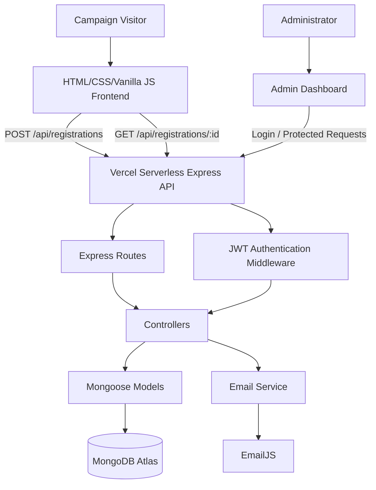
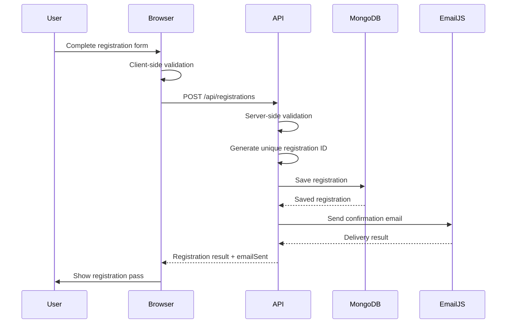
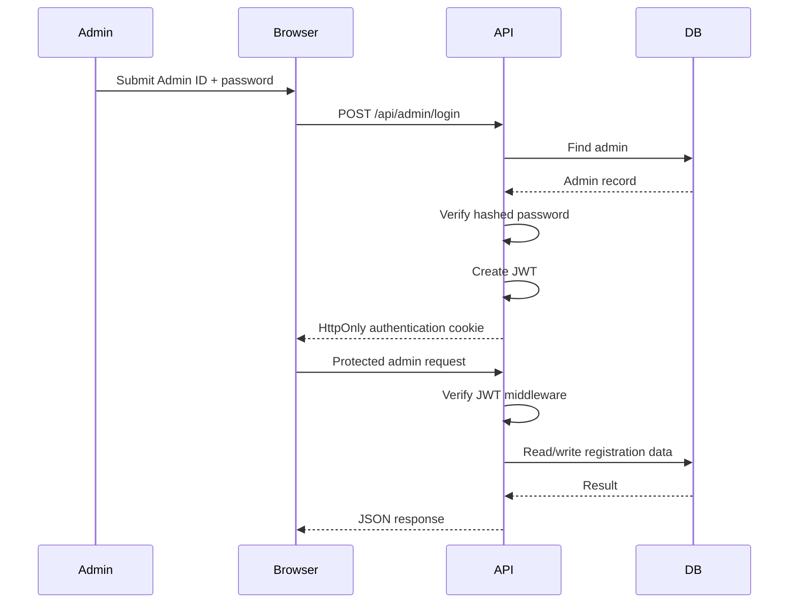

# HPPCHRI Campaign

A full-stack campaign and registration platform for the **Homi Bhabha Cancer Hospital & Research Institute (HPPCHRI)** youth awareness campaign. The application combines a responsive public campaign website, participant registration, digital registration passes, public registration verification, an authenticated administration dashboard, MongoDB persistence, and transactional email support.

> **Live application:** https://hppchri-campaign.vercel.app/
>
> **Repository:** https://github.com/Shrestha-Gupta/HPPCHRI-Campaign

---

## Table of Contents

- [Overview](#overview)
- [Key Features](#key-features)
- [Technology Stack](#technology-stack)
- [Architecture](#architecture)
- [Application Flow](#application-flow)
- [Project Structure](#project-structure)
- [Frontend](#frontend)
- [Backend](#backend)
- [Database Design](#database-design)
- [API Reference](#api-reference)
- [Authentication and Security](#authentication-and-security)
- [Environment Variables](#environment-variables)
- [Prerequisites](#prerequisites)
- [Local Development](#local-development)
- [Admin Setup](#admin-setup)
- [MongoDB Setup](#mongodb-setup)
- [EmailJS Setup](#emailjs-setup)
- [Vercel Deployment](#vercel-deployment)
- [Troubleshooting](#troubleshooting)
- [Production and Security Guidelines](#production-and-security-guidelines)
- [Current Implementation Notes](#current-implementation-notes)
- [Future Improvements](#future-improvements)
- [Contributing](#contributing)
- [License](#license)
- [Acknowledgements](#acknowledgements)
- [Author](#author)

---

## Overview

HPPCHRI Campaign is a production-oriented web platform created to support a youth-focused awareness and registration campaign. The project is intentionally lightweight on the client side while providing a structured Node.js/Express backend for persistent data, administration, authentication, and email delivery.

The system is designed around four primary experiences:

1. **Public campaign experience** — visitors can explore the campaign, hospital information, awareness material, and the interactive quiz.
2. **Participant registration** — eligible participants can submit their details through a validated registration form.
3. **Digital pass and verification** — every successful registration receives a unique registration ID that can be used to access/verify the registration pass.
4. **Administration** — authorized administrators can authenticate and manage registration records from a protected dashboard.

---

## Key Features

### Public Website

- Responsive campaign landing page.
- Campaign and institutional information.
- Awareness-focused content and pledge flow.
- Responsive navigation and mobile-friendly layout.
- Countdown and interactive UI elements.
- Social/communication links used by the campaign.

### Registration

- Public registration form.
- Client-side form validation.
- Server-side validation.
- Required email and contact information.
- Category-based/conditional registration fields.
- Unique registration ID generation.
- MongoDB-backed persistent registration records.
- Registration success/pass experience.

### Digital Registration Pass

- Registration ID based participant pass.
- Participant details displayed after successful registration.
- Print-friendly pass layout.
- Download/print support.
- WhatsApp sharing support.
- Green pass presentation retained for print output.

### Registration Verification

- Public registration verification using the registration ID.
- Verification endpoint does not expose the full administrative record.

### Awareness Quiz

- Interactive tobacco-awareness quiz.
- Client-side quiz logic.
- Result/interaction handling without requiring a database-backed quiz account.

### Admin Dashboard

- Dedicated admin login.
- JWT-based authenticated session.
- HttpOnly authentication cookie.
- Protected administration endpoints.
- Registration listing.
- Search/filter functionality.
- Registration details.
- Add registration.
- Update registration.
- Delete registration.
- Registration statistics.
- CSV export.
- Legacy registration migration support.
- Logout/session validation.

### Email

- EmailJS integration from the backend.
- Registration confirmation email support.
- Email delivery status returned separately from registration persistence.
- Registration is not rolled back solely because an email provider fails.

---

## Technology Stack

| Layer | Technology |
|---|---|
| Frontend | HTML5, CSS3, Vanilla JavaScript |
| Backend | Node.js, Express.js |
| Database | MongoDB Atlas |
| ODM | Mongoose |
| Authentication | JWT + HttpOnly cookies |
| Password security | bcrypt/bcryptjs-based password hashing |
| Email | EmailJS REST integration |
| Deployment | Vercel |
| API style | REST/JSON |
| Development | npm |

The project does not require React, Next.js, or another frontend framework. The public interface is implemented with standard HTML, CSS, and JavaScript.

---

## Architecture



### Production request routing

```text
Browser
   |
   | /api/*
   v
Vercel
   |
   | rewrite configured by vercel.json
   v
api/index.js
   |
   v
server/app.js
   |
   +--> routes
          |
          +--> controllers
                 |
                 +--> MongoDB / EmailJS
```

### Local request routing

```text
Browser
   |
   v
Express application
   |
server/server.js
   |
server/app.js
   |
+--> MongoDB Atlas
+--> EmailJS
```

The separation between `server.js` and `app.js` allows the same Express application to be used both for local development and as a Vercel serverless handler.

---

## Application Flow

### Participant registration flow



### Admin authentication flow



---

## Project Structure

```text
HPPCHRI-Campaign/
│
├── api/
│   └── index.js                  # Vercel serverless Express entry point
│
├── assets/                       # Campaign images, logos and static assets
│   ├── hppchri_logo.png
│   ├── golden_jubilee_logo.png
│   ├── hospital_building.jpg
│   ├── hospital_interior.png
│   ├── cm_yogi_adityanath.jpg
│   ├── governor_anandiben_patel.jpg
│   └── ...
│
├── css/
│   └── style.css                 # Main responsive stylesheet
│
├── js/
│   ├── app.js                    # Global UI/navigation/countdown/client utilities
│   ├── quiz.js                   # Awareness quiz logic
│   └── registration.js            # Registration and pass workflow
│
├── server/
│   ├── config/
│   │   └── db.js                 # MongoDB/Mongoose connection
│   │
│   ├── controllers/
│   │   ├── adminController.js    # Admin authentication and management logic
│   │   └── registrationController.js
│   │                              # Registration/business logic
│   │
│   ├── middleware/
│   │   └── authMiddleware.js     # JWT authentication middleware
│   │
│   ├── models/
│   │   ├── Admin.js              # Admin schema/model
│   │   └── Registration.js       # Registration schema/model
│   │
│   ├── routes/
│   │   ├── adminRoutes.js        # Admin API routes
│   │   └── registrationRoutes.js # Public registration routes
│   │
│   ├── scripts/
│   │   └── seedAdmin.js          # Initial/admin account seeding utility
│   │
│   ├── services/
│   │   └── emailService.js       # EmailJS integration
│   │
│   ├── app.js                    # Express app configuration
│   ├── server.js                 # Local server entry point
│   └── package.json              # Backend dependencies/scripts
│
├── admin.html                    # Admin login/dashboard UI
├── index.html                    # Public campaign website
├── pass.html                     # Registration pass/verification page
├── package.json                  # Root/Vercel dependencies
├── package-lock.json             # Locked root dependencies
└── vercel.json                   # Vercel routing/deployment configuration
```

> The asset list above is representative rather than exhaustive; the `assets/` directory contains the campaign's static media used by the frontend.

---

## Frontend

### `index.html`

The main public-facing application contains the campaign presentation, awareness information, registration experience, campaign links, and quiz entry point.

### `js/app.js`

Responsible for client-side application behavior such as navigation, interactive sections, countdown/UI behavior, and browser-side utilities. It also contains legacy/sample-data support used by the existing application flow.

### `js/registration.js`

Handles the registration form workflow, including:

- Required-field validation.
- Email format validation.
- API submission.
- Registration success handling.
- Registration ID/pass rendering.
- Pass download/print behavior.
- WhatsApp sharing.
- Submit-button state management.

### `js/quiz.js`

Contains the client-side logic for the awareness quiz.

### `css/style.css`

Contains the primary responsive visual system for the campaign website, registration experience, pass presentation, navigation, cards, sections, and print behavior.

### `admin.html`

Provides the administration interface. The page supports login and, after authentication, registration management features exposed by the backend.

### `pass.html`

Provides the pass/verification experience associated with registration IDs.

---

## Backend

The backend follows a conventional Express layered architecture:

```text
Request
  ↓
Route
  ↓
Controller
  ↓
Model / Service
  ↓
MongoDB / EmailJS
  ↓
JSON Response
```

### `server/app.js`

Creates/configures the Express application and mounts middleware and API routes. This module is reusable by the local server and the Vercel serverless entry point.

### `server/server.js`

Local development entry point. It imports the Express application and starts an HTTP listener.

### `server/routes/`

Defines API endpoints and delegates request processing to controllers.

### `server/controllers/`

Contains application/business logic for registration and administrative operations.

### `server/models/`

Contains Mongoose schemas and models used for persistent storage.

### `server/middleware/authMiddleware.js`

Validates the JWT authentication cookie before allowing protected administration requests to continue.

### `server/services/emailService.js`

Provides the backend abstraction for sending registration confirmation emails through EmailJS's REST API.

### `server/scripts/seedAdmin.js`

Provides a controlled way to create the initial admin account from environment-provided credentials.

---

## Database Design

MongoDB Atlas is the persistent datastore and Mongoose is used as the ODM.

### Registration collection

The registration model stores the participant's registration identity and campaign-related information, including fields such as:

- Unique registration ID.
- Participant name.
- Email address.
- Phone/contact information.
- Participant category.
- Institution/organization information where applicable.
- City/location information where collected.
- Social/communication information where collected.
- Awareness/pledge information.
- Registration metadata/timestamps.

The exact schema in `server/models/Registration.js` is the source of truth for field names and validation rules.

### Admin collection

The admin model stores:

- Admin identifier.
- Password hash.
- Creation/update timestamps.
- Password verification behavior defined by the model.

Passwords are not stored as plain text.

### Data flow

```text
Registration Form
      ↓
Express Controller
      ↓
Mongoose Validation
      ↓
MongoDB Atlas
      ↓
Persistent Registration
```

---

## API Reference

### Base URLs

Production:

```text
https://hppchri-campaign.vercel.app/api
```

Local development:

```text
http://localhost:5000/api
```

> The local port is controlled by the backend configuration/environment when applicable.

---

### Public Registration API

#### `POST /registrations`

Creates a new participant registration.

**Authentication:** None

**Typical request:**

```json
{
  "name": "Participant Name",
  "email": "participant@example.com",
  "phone": "9876543210",
  "category": "Student"
}
```

The actual accepted request body follows the validation implemented in `registrationController.js`; additional campaign-specific fields may be required depending on the selected category.

**Successful response concept:**

```json
{
  "success": true,
  "registrationId": "HPP-YS-50-1234",
  "emailSent": true
}
```

`emailSent` represents email-service status. A successful database registration is not made dependent on successful email delivery.

---

### Public Registration Verification

#### `GET /registrations/:registrationId`

Retrieves the public verification/pass information associated with a registration ID.

**Authentication:** None

Example:

```text
GET /api/registrations/HPP-YS-50-1234
```

The public endpoint is intentionally separate from the authenticated admin APIs and should not be treated as an administrative data-access endpoint.

---

## Admin API

All endpoints in this section except login/logout are protected by JWT authentication.

### `POST /admin/login`

Authenticates an administrator and establishes the JWT session cookie.

Example request:

```json
{
  "adminId": "your-admin-id",
  "password": "your-admin-password"
}
```

### `POST /admin/logout`

Clears the authenticated admin session.

### `GET /admin/me`

Checks whether the current admin session is valid.

### `GET /admin/registrations`

Returns the registration records available to an authenticated administrator.

### `GET /admin/registrations/:registrationId`

Returns a specific registration for administrative viewing.

### `POST /admin/registrations`

Creates a registration record from the authenticated admin dashboard.

### `PUT /admin/registrations/:registrationId`

Updates an existing registration.

### `DELETE /admin/registrations/:registrationId`

Deletes a registration record.

### `POST /admin/migrate`

Triggers the application's legacy-registration migration functionality.

### `GET /health`

Returns backend health information and can be used as a basic deployment/API availability check.

> For exact request/response fields and validation behavior, `server/routes/` and the corresponding controllers are the authoritative implementation. This README deliberately avoids inventing fields that are not guaranteed by the source code.

---

## Authentication and Security

The administration layer uses:

- JWT-based authentication.
- HttpOnly cookies for the authentication token.
- Password hashing rather than plain-text password storage.
- Middleware-based protection of admin endpoints.
- Separate public and protected API routes.
- Server-side validation in addition to browser-side validation.
- Environment variables for secrets and provider credentials.

### Authentication model

```text
Admin credentials
      ↓
POST /admin/login
      ↓
Verify password hash
      ↓
Create JWT
      ↓
Set HttpOnly cookie
      ↓
Protected request
      ↓
JWT middleware
      ↓
Controller
```

### Important security rule

Never commit the following to GitHub:

- MongoDB connection strings containing credentials.
- JWT secrets.
- Admin passwords.
- EmailJS private keys.
- Production API credentials.
- Any `.env` file containing real secrets.

Use `.env` locally and Vercel Environment Variables in production.

---

## Environment Variables

The application expects configuration to be supplied through environment variables. Use the exact variable names required by the current source code.

```env
MONGODB_URI=
JWT_SECRET=
JWT_EXPIRES_IN=
NODE_ENV=
PORT=
FRONTEND_URL=

ADMIN_ID=
ADMIN_PASSWORD=

EMAILJS_SERVICE_ID=
EMAILJS_TEMPLATE_ID=
EMAILJS_PUBLIC_KEY=
EMAILJS_PRIVATE_KEY=
```

### Variable purpose

| Variable | Purpose |
|---|---|
| `MONGODB_URI` | MongoDB Atlas connection string |
| `JWT_SECRET` | Secret used to sign/verify admin JWTs |
| `JWT_EXPIRES_IN` | JWT lifetime configuration |
| `NODE_ENV` | Runtime environment configuration |
| `PORT` | Local HTTP server port |
| `FRONTEND_URL` | Frontend/production origin configuration where used |
| `ADMIN_ID` | Initial admin identifier used by the seeding workflow |
| `ADMIN_PASSWORD` | Initial admin password used by the seeding workflow |
| `EMAILJS_SERVICE_ID` | EmailJS service identifier |
| `EMAILJS_TEMPLATE_ID` | EmailJS template identifier |
| `EMAILJS_PUBLIC_KEY` | EmailJS public key used by the email integration |
| `EMAILJS_PRIVATE_KEY` | EmailJS private/server credential |

> Do not copy real credentials into this README. The repository's environment files/templates should contain placeholders only.

---

## Prerequisites

Install the following before running the project locally:

- Node.js (an actively supported LTS release is recommended).
- npm.
- A MongoDB Atlas account/database.
- An EmailJS account if confirmation emails are required.
- Git.

Verify Node/npm:

```bash
node --version
npm --version
```

---

## Local Development

### 1. Clone the repository

```bash
git clone https://github.com/Shrestha-Gupta/HPPCHRI-Campaign.git
cd HPPCHRI-Campaign
```

### 2. Install root dependencies

```bash
npm install
```

### 3. Install backend dependencies

```bash
cd server
npm install
cd ..
```

### 4. Configure environment variables

Create the environment file expected by the backend and provide the MongoDB, JWT, admin, and EmailJS values described in [Environment Variables](#environment-variables).

Do not commit the real file.

### 5. Start the backend

From the backend directory, run the server's development/start command defined in `server/package.json`.

```bash
cd server
npm start
```

If the project is being run with a different development script configured in the current `package.json`, use that script instead.

### 6. Open the frontend

The frontend consists of static HTML/CSS/JavaScript files. For development, serve the repository through a local static server rather than relying on browser `file://` behavior when API requests are involved.

For example, a static-server tool can serve the project root while the Express backend runs separately.

### 7. Test the API

Use the health endpoint:

```text
http://localhost:5000/api/health
```

Then test registration and admin flows from the browser.

---

## Admin Setup

The project includes `server/scripts/seedAdmin.js` for creating an initial administrative account.

Recommended workflow:

1. Configure `ADMIN_ID` and `ADMIN_PASSWORD` in the backend environment.
2. Configure `MONGODB_URI`.
3. Run the admin seeding script from the `server` directory using the script exposed by `server/package.json`.
4. Open `admin.html`.
5. Authenticate using the seeded credentials.
6. Change/rotate credentials according to the deployment's operational policy if the application is used beyond development.

Never hard-code production credentials into source code.

---

## MongoDB Setup

1. Create a MongoDB Atlas project.
2. Create a database deployment/cluster.
3. Create a database user with the minimum permissions required by the application.
4. Configure Network Access appropriately.
5. Copy the application connection string.
6. Set it as `MONGODB_URI`.
7. Start the backend and confirm the database connection.

### Development network access

For temporary development/testing, broader IP access may be used when necessary. For production, restrict MongoDB network access to trusted sources and avoid leaving an unrestricted `0.0.0.0/0` rule enabled unless there is a deliberate, documented reason and compensating controls.

---

## EmailJS Setup

The project sends registration confirmation mail through an EmailJS-backed service abstraction in:

```text
server/services/emailService.js
```

### Setup

1. Create/configure an EmailJS service.
2. Create the registration confirmation template.
3. Obtain the required EmailJS identifiers/credentials.
4. Set:

```env
EMAILJS_SERVICE_ID=
EMAILJS_TEMPLATE_ID=
EMAILJS_PUBLIC_KEY=
EMAILJS_PRIVATE_KEY=
```

5. Deploy/restart the backend.
6. Submit a test registration.
7. Verify both the registration record and the email delivery status.

### Important behavior

Registration persistence and email delivery are separate operations. If MongoDB successfully saves the participant but EmailJS fails, the registration can still be successful while the API reports an unsuccessful `emailSent` state.

This prevents a temporary email-provider failure from unnecessarily discarding a valid registration.

---

## Vercel Deployment

The repository contains a Vercel-specific serverless entry point:

```text
api/index.js
```

and routing configuration:

```text
vercel.json
```

### Deployment model

```text
GitHub Repository
       ↓
     Vercel
       ↓
Static frontend assets
       +
/api/* → api/index.js
       ↓
Express app
       ↓
MongoDB Atlas / EmailJS
```

### Deployment steps

1. Import the GitHub repository into Vercel.
2. Use the repository root as the project root.
3. Keep the Vercel configuration from `vercel.json`.
4. Add all production environment variables in Vercel's project settings.
5. Deploy.
6. Open the production URL.
7. Test:
   - Public campaign page.
   - Registration submission.
   - Registration pass.
   - Public registration verification.
   - Admin login.
   - Admin registration listing.
   - CSV export.
   - Email delivery.

### Why `api/index.js` exists

Vercel's serverless runtime needs an exported request handler rather than a long-running `app.listen()` process. `api/index.js` provides that bridge while `server/server.js` remains suitable for local execution.

---

## Troubleshooting

### Registration fails

Check:

1. Browser network request and response.
2. Backend deployment/runtime logs.
3. `MONGODB_URI`.
4. MongoDB Atlas Network Access.
5. MongoDB user permissions.
6. Server-side validation errors.

### Registration succeeds but email is not received

Check:

1. `EMAILJS_SERVICE_ID`.
2. `EMAILJS_TEMPLATE_ID`.
3. `EMAILJS_PUBLIC_KEY`.
4. `EMAILJS_PRIVATE_KEY`.
5. EmailJS template variables.
6. EmailJS service status/logs.
7. Spam/junk folder.
8. API response's `emailSent` value.

### Admin login fails

Check:

1. Admin credentials were seeded correctly.
2. `MONGODB_URI` points to the intended database.
3. The stored password is hashed through the model/seeding workflow.
4. `JWT_SECRET` is configured.
5. Cookies are being sent by the browser.
6. Production origin/cookie settings are compatible with the deployment.

### Admin dashboard loads but API requests fail

Check:

1. The browser's Network tab.
2. `/api/admin/me` response.
3. Authentication cookie.
4. Vercel function logs.
5. `vercel.json` routing.
6. Backend environment variables.

### Vercel deployment works for the page but API does not

Check:

1. `api/index.js` exists at the repository root.
2. `vercel.json` is present.
3. `/api/*` rewrite configuration is deployed.
4. Production environment variables are configured in Vercel.
5. MongoDB Atlas allows the production runtime to connect.

---

## Production and Security Guidelines

Before treating a deployment as production-ready:

- Use strong, unique admin credentials.
- Rotate `JWT_SECRET` when required by your operational policy.
- Keep all secrets outside Git.
- Restrict MongoDB network access as much as practical.
- Use a least-privilege MongoDB user.
- Keep dependencies updated and review security advisories.
- Keep the public verification response limited to the information required by the campaign.
- Do not expose administrative endpoints without JWT protection.
- Review Vercel logs for failed requests and unexpected behavior.
- Do not reuse development credentials in production.
- Test email delivery after every production configuration change.
- Back up important registration data according to the campaign's operational requirements.

---

## Current Implementation Notes

### Registration IDs

The application uses a human-readable registration identifier in the form:

```text
HPP-YS-50-XXXX
```

The generated identifier is persisted with the registration and used by the pass/verification workflow.

### Email delivery is not the source of truth

MongoDB is the source of truth for registration persistence. EmailJS is a notification channel. A participant should not be considered unregistered solely because an email could not be delivered.

### Legacy data migration

The application includes a migration path for legacy registration data. This exists for compatibility with the earlier client-side registration/data workflow and should be treated as an operational migration mechanism rather than the primary storage architecture.

### Sample/legacy client-side data

The existing frontend contains legacy/sample-data handling. Production registration data should be considered authoritative only when it is persisted by the backend in MongoDB.

### Public vs. administrative access

Public registration verification and administrative registration management are deliberately different access levels. The public verification endpoint should not be documented or treated as a substitute for admin authentication.

### Print behavior

The registration pass includes print-specific styling so that the pass remains visually usable when printed or saved through the browser's print flow.

---

## Future Improvements

Potential improvements that fit the current architecture include:

- Automated API/integration tests.
- Automated frontend form tests.
- Formal OpenAPI/Swagger documentation.
- Stronger server-side rate limiting for public registration endpoints.
- More granular admin roles/permissions.
- Audit logging for administrative changes.
- Pagination for large registration datasets.
- Server-side CSV generation for very large datasets.
- Automated database backup/retention policy.
- CI/CD checks for linting, tests, and dependency vulnerabilities.
- Centralized structured logging and monitoring.
- Stronger registration-ID generation using a cryptographically secure/random or database-backed sequence strategy if the scale requires it.
- Dedicated production email monitoring and retry handling.
- Automated end-to-end deployment smoke tests.

These are future opportunities, not claims about functionality already present in the repository.

---

## Contributing

1. Fork the repository.
2. Create a feature branch:

```bash
git checkout -b feature/your-feature
```

3. Make focused changes.
4. Test frontend, backend, database, and deployment behavior relevant to the change.
5. Commit with a clear message:

```bash
git commit -m "feat: describe the change"
```

6. Push the branch.
7. Open a pull request with:
   - Problem statement.
   - Implementation summary.
   - Testing performed.
   - Screenshots for UI changes where useful.
   - Deployment/configuration considerations where relevant.

---

## License

No `LICENSE` file is currently present in the repository. Therefore, this project should **not** be assumed to have an open-source license. Copyright and reuse permissions should be clarified by the project owner before redistribution or commercial reuse.

---

## Acknowledgements

- **Homi Bhabha Cancer Hospital & Research Institute (HPPCHRI)** for the campaign/institutional context represented by the platform.
- Campaign stakeholders and contributors involved in the youth awareness initiative.
- The open-source Node.js, Express, Mongoose, MongoDB, Vercel, and related tooling ecosystems used to build and deploy the platform.

---

## Author

**Shrestha Gupta**

- GitHub: https://github.com/Shrestha-Gupta
- Project Repository: https://github.com/Shrestha-Gupta/HPPCHRI-Campaign
- Live Project: https://hppchri-campaign.vercel.app/

---

## Project Snapshot

| Area | Implementation |
|---|---|
| Frontend | HTML + CSS + Vanilla JavaScript |
| Backend | Node.js + Express.js |
| Database | MongoDB Atlas + Mongoose |
| Authentication | JWT + HttpOnly cookie |
| Admin | Protected dashboard with registration management |
| Email | EmailJS backend integration |
| Deployment | Vercel serverless architecture |
| Public verification | Registration ID based |
| Registration pass | Digital + print/share workflow |
| Quiz | Client-side awareness quiz |

---

**Built as a complete campaign registration and administration platform with a lightweight frontend, structured backend, persistent database, authenticated operations, and cloud deployment.**
